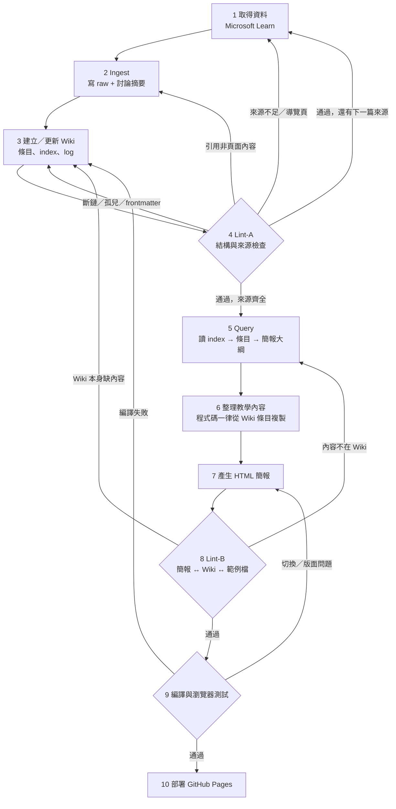

# Loop / Graph：從來源到簡報的工作流程

## 流程圖（修正後版本 v2）

## 文字說明

### 資料如何轉換
1. **來源 → raw**：每篇 Microsoft Learn 頁面寫成 `raw/source-XX.md`，只記錄「頁面本身寫了什麼」，擷取工具補充的一般知識隔離在「非頁面內容（不可引用）」區塊。
2. **raw → Wiki**：先在 `log.md` 寫討論摘要（重點、預計更新哪些條目），再寫 `wiki/*.md`；每個事實標註〔Sxx〕。
3. **Wiki → 簡報**：Query 先讀 `index.md`，產出 `wiki/queries/slide-outline.md`（投影片 ↔ 條目對應表，並存回 Wiki）；簡報每張以 `data-wiki` 標示條目，程式碼從條目複製，同步存到 `tools/examples/`。

### 哪些步驟會重複
- **2 → 3 → 4** 每篇來源跑一次（本次跑了 8 次，含 1 篇被退回的來源）。
- **4 Lint-A** 每次更新 Wiki 後都跑，不等到最後。
- **7 → 8 → 9** 每次修改簡報都重跑。

### 何時返回前面的節點
| 觸發條件 | 返回 |
|---|---|
| 來源是導覽頁或內容不足 | 1 取得資料 |
| Wiki 引用了 raw「非頁面內容」區塊 | 2 Ingest |
| 斷鏈、孤兒條目、frontmatter 與內文來源不一致、index 漏列 | 3 建立 Wiki |
| 簡報程式碼或內容在對應條目找不到 | 5 Query（重新從 Wiki 取內容） |
| 範例編譯失敗 | 3 先修 Wiki，再重新產生簡報 |
| 投影片無法切換、版面跑掉 | 7 產生 HTML |

### 為什麼這樣設計檢查
- **Lint-A 放在 Wiki 之後、Query 之前**：Wiki 是簡報唯一的知識來源，Wiki 錯了，後面全錯，所以要在進入 Query 前擋下。
- **Lint-B 檢查「簡報程式碼 ⊂ Wiki 條目」**：確保簡報沒有繞過 Wiki、直接從 raw 或模型記憶生成內容。
- **編譯檢查**：給初學者的程式碼若無法編譯，教學價值歸零；這是文字檢查抓不到的錯誤，所以用真正的 C# 編譯器驗證。
- **擷取內容隔離**：網頁擷取工具會把一般知識混入回傳結果，若不隔離，Wiki 會出現「看起來有出處、其實沒有」的內容。

## v1 → v2 的修改
v1（最初規劃）：取得資料 → Ingest → 建立 Wiki → Query → 整理教學內容 → 檢查正確性 → 產生 HTML → 測試，**只有一個檢查點，放在最後**。

v2 依實際執行結果修改（細節見 `log.md` 與 `docs/run-record.md`）：
1. 檢查拆成 **Lint-A（Wiki 結構與來源）** 與 **Lint-B（簡報與 Wiki 一致性）**，Lint-A 提前到每次更新 Wiki 後。
2. 「整理教學內容」加上規則：程式碼一律從 Wiki 條目複製，不從 raw 複製。
3. 加入「編譯與瀏覽器測試」節點。
